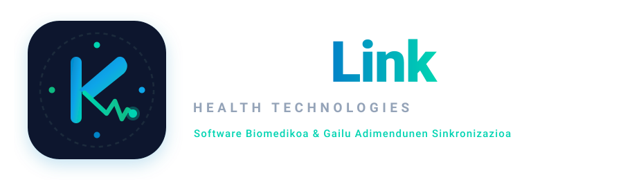

# KuraLink Health Technologies — Negozio Ideiaren Garapena

> **Ikaslea / Garatzailea:** Multiplataforma Garapena (DAM) & Biomedikuntza Ingeniaritza  
> **Modulua:** Enplegagarritasunerako Ibilbide Pertsonala II (EIP II) — 2. Ebaluazioko Erronka  
> **Ikastetxea:** Goierri Eskola (Ordizia, Gipuzkoa)  
> **Egoitza Fiktizioa:** Gipuzkoako Parke Zientifiko eta Teknologikoa (Miramon, Donostia)

---

## Proiektuaren Deskribapena

**KuraLink Health Technologies S.L.** biomedikuntza ingeniaritzaren eta multiplataforma software garapenaren (DAM) arteko sinergian oinarritutako osasun digitaleko (*Digital Health*) startup fiktizio bat da. 

Biztanleriaren zahartze azkarrak (%23,5etik gora 65 urtetik gorakoak Euskadin) eta gaixo kronikoen gainkargak ospitaleak saturatuta utzi dituzte. KuraLink-ek gailu mediko eramangarriak (BLE bidezko adabaki kardiakoak eta IMU mugimendu-sentsoreak) zero-touch bidez automatikoki sinkronizatzen dituen eta Osakidetzako historian (**Osabide Global / HL7 FHIR**) zuzenean integratzen den **SaMD (Software as a Medical Device - Klasea IIa)** plataforma eskaintzen du.

---

## Biltegiaren Egitura

* **📁 `01_negozio_proiektua_memoria/`**
  * `Negozio_Ideiaren_Garapena_KuraLink.md`: Irakaslearen teoria-gidaliburuko 5 atalak zehatz-mehatz garatuta (Arazoa/Irtenbidea, Misioa/Bisioa/Baloreak, Target B2B2C, Balio Proposamena eta Marka).
  * `KuraLink_Lean_Canvas.md`: Proiektuaren Lean Canvas ekintzailetza taula osoa.
* **📁 `02_marka_eta_identitate_bisuala/`**
  * `kuralink_logo.svg`: Logotipo bektorial nagusia.
  * `kuralink_icon.svg`: Mugikorrerako aplikazio ikonoa / Isotipoa.
  * `marka_gida.md`: Kolore korporatiboak, tipografia eta branding arauak.
* **📁 `03_irudiak_eta_mockupak/`**
  * `kuralink_enpresa_irudia.jpg`: Miramongo egoitza eta I+G software laborategiaren argazki errealista.
  * `kuralink_app_mockup.jpg`: KuraLink aplikazioa smartphonean eta BioPatch sentsorea mahai gainean.
* **📁 `04_merkatu_azterketa_eta_datuak/`**
  * `lan_mundua_eta_demanda_azterketa.md`: Datu estatistikoak, lan-beharrak eta SaMD merkatuaren analisia.
* **📁 `kuralink_web_app/`**
  * Single Page Web App interaktiboa (Figma UI, EKG Canvas dinamikoa, BLE parekatze simulagailua eta ospitaleen ROI kalkulagailua). Zero emotikono, ikono bektorial garbiak soilik.
* **📁 `kuralink_android_app/`**
  * Android Studio proiektu natiboa (Kotlin + Jetpack Compose + Material Design 3 + BLE baimenak).
* **📄 `proiektuaren_aurkezpena.html`**
  * Aurkezpen web-orria nabigatzailean irekitzeko.

---

## Nola Exekutatu

### 1. Web App Interaktiboa Nabigatzailean
Ireki `kuralink_web_app/index.html` edozein nabigatzaile modernotan (Chrome, Firefox, Edge, Safari). Ez du instalaziorik behar.

### 2. Android Studio Aplikazioa
1. Ireki Android Studio.
2. Hautatu `Open` eta aukeratu `kuralink_android_app` direktorioa.
3. Sinkronizatu Gradle eta exekutatu gailu fisikoan edo emuladorean (API 26+).

---

## Egilea eta Lizentzia

Proiektu hau Goierri Eskolako EIP II moduluaren 2. ebaluazioko erronkarako garatu da.  
MIT Lizentziapean argitaratua.
